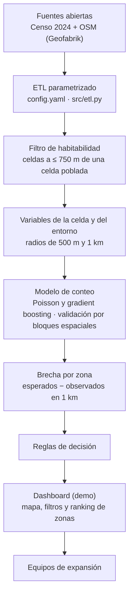
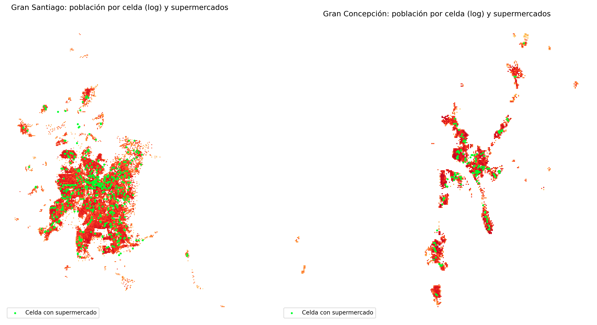
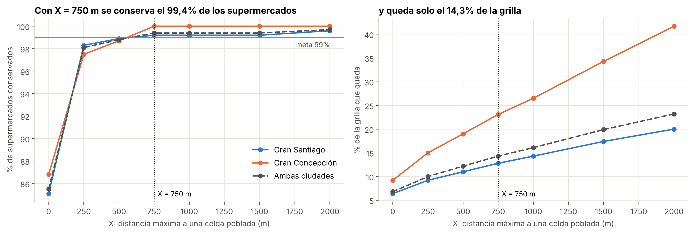
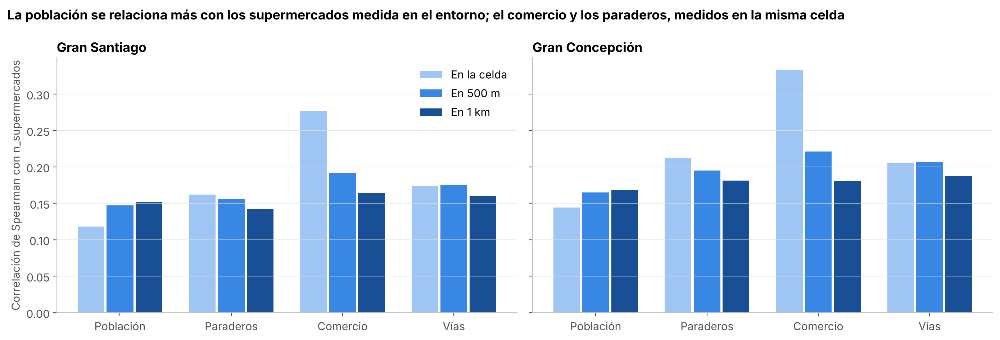

# ¿Dónde abrir el próximo supermercado? 🛒🗺️

Proyecto del curso *Data Analysis and Machine Learning* (Trabajo BI-ML 2026, Ingeniería Industrial, Universidad de Concepción). Usa solo datos abiertos, Censo 2024 y OpenStreetMap, para encontrar zonas del Gran Santiago y del Gran Concepción que hoy tienen menos supermercados de los que su demanda y accesibilidad harían esperar.

> **Estado:** v2.0 en desarrollo. El ETL v2, el filtro de celdas inhabitables y las variables de entorno están listos y corridos con los datos reales; el diagnóstico espacial, el modelo y el dashboard vienen en las próximas iteraciones (ver [Historial de versiones](#historial-de-versiones)). La versión presentada en el avance queda en el tag [`v1.0`](https://github.com/MateoJr182/supermarket-location-analytics/tree/v1.0).

## Contenido

1. [Problema, pregunta y usuarios](#1-problema-pregunta-y-usuarios)
2. [Datos](#2-datos)
3. [Arquitectura y pipeline](#3-arquitectura-y-pipeline)
4. [Decisiones metodológicas](#4-decisiones-metodológicas)
5. [Resultados](#5-resultados)
6. [Riesgos de datos y limitaciones](#6-riesgos-de-datos-y-limitaciones)
7. [Cómo reproducir](#7-cómo-reproducir)
8. [Estructura del repositorio](#8-estructura-del-repositorio)
9. [Historial de versiones](#historial-de-versiones)
10. [Referencias](#referencias)

---

## 1. Problema, pregunta y usuarios

Abrir un supermercado es una inversión alta y difícil de revertir. Hoy la búsqueda de zonas se hace con estudios de mercado y visitas a terreno caso a caso, lo que es caro y difícil de repetir en otra ciudad. Falta un **primer filtro barato y replicable** que reduzca las zonas a estudiar.

**Pregunta de investigación**

> Con la oferta y el entorno urbano actuales (Censo 2024 + OSM), ¿qué zonas del Gran Santiago y del Gran Concepción tienen hoy menos supermercados de los que su demanda y accesibilidad harían esperar?

- El modelo aprende, con ambas ciudades a la vez, cuántos supermercados corresponden a cada contexto: demanda en el entorno, accesibilidad y actividad comercial.
- La oportunidad de cada zona es la **brecha = supermercados esperados − observados** en un radio caminable de 1 km.
- Es un corte transversal con datos de un solo momento: **no predice cómo crecerá la ciudad**, sino dónde conviene ubicar un supermercado hoy.

**Usuarios**

- Equipos de expansión de cadenas de supermercados, que usan el ranking de zonas como primer filtro antes del estudio de mercado y la visita a terreno.
- Municipios y planificadores interesados en el acceso a alimentos.

## 2. Datos

| Fuente | Archivo en `data/raw/` | Qué se usa | Fecha |
| --- | --- | --- | --- |
| [OpenStreetMap Chile (Geofabrik)](https://download.geofabrik.de/south-america/chile.html) | `chile.gpkg` | Vías, paraderos, uso de suelo residencial y 11 categorías de puntos de interés (puntos y polígonos) | Extracto del 2026-10-02 |
| [Censo 2024, manzanas (INE)](https://censo2024.ine.gob.cl/resultados/) | `Cartografia_censo2024_Pais_Manzanas.parquet` | Personas por manzana (`n_per`) | Censo 2024 |
| [Censo 2024, comunas (INE)](https://censo2024.ine.gob.cl/resultados/) | `Cartografia_censo2024_Pais_Comunal.parquet` | Límites comunales para armar cada ciudad | Censo 2024 |

**Áreas de estudio** (definidas en `config.yaml`)

- **Gran Santiago:** 39 comunas.
- **Gran Concepción:** 9 comunas: Concepción, Talcahuano, Hualpén, San Pedro de la Paz, Chiguayante, Penco, Coronel, Lota y Tomé. El Área Metropolitana oficial tiene 11; Hualqui y Santa Juana quedan fuera por ser mayormente rurales.

**Resumen por ciudad** (ETL v2, celdas de 250 m)

| | Gran Santiago | Gran Concepción |
| --- | ---: | ---: |
| Comunas | 39 | 9 |
| Habitantes (Censo 2024) | 6.532.737 | 954.408 |
| Supermercados (OSM) | 524 | 159 |
| Paraderos y estaciones | 12.416 | 2.460 |
| Puntos de interés (11 categorías, incluye supermercados) | 8.396 | 1.497 |
| Celdas | 148.932 | 25.233 |
| Celdas pobladas | 9.585 | 2.317 |

**Unidad de análisis:** celda cuadrada de 250 × 250 m (tamaño principal), con versiones de 125, 500 y 1000 m y una grilla de 250 m desplazada 125 m para el análisis de sensibilidad.

**Tablas de salida:** `data/processed/celdas_<ciudad>_<tamaño>m.parquet`, una fila por celda.

| Columna | Descripción |
| --- | --- |
| `id_celda` | Identificador estable: `<ciudad>_<tamaño>_<ix>_<iy>` |
| `ciudad`, `tamano_m`, `desfase_m` | Ciudad (`stgo`, `ccp`), lado de la celda en metros y desplazamiento de la grilla |
| `ix`, `iy`, `x`, `y` | Posición de la celda en la grilla y su centro en metros (UTM, ver `crs_utm`) |
| `frac_dentro` | Fracción de la celda dentro del área de estudio (1 = completa) |
| `n_supermercados` | **Variable objetivo:** supermercados OSM en la celda |
| `conteo_paraderos` | Paraderos y estaciones (`bus_stop`, `bus_station`, `station`) |
| `conteo_<categoría>` | Almacenes, malls, farmacias, ferias, colegios, universidades, institutos, hospitales, clínicas y recintos deportivos |
| `poblacion_celda` | Personas del Censo 2024 cuyo centroide de manzana cae en la celda |
| `largo_vias_m` | Metros de vías `primary`, `secondary`, `tertiary` y `trunk` en la celda |
| `dist_via_principal_m` | Distancia del centro de la celda a la vía `primary` o `trunk` más cercana |
| `frac_residencial` | Fracción del área de la celda con uso de suelo residencial en OSM |

**Tablas para el modelo:** `data/processed/modelo_<tamaño>m.parquet`, con ambas ciudades y solo las celdas habitables (a 750 m o menos de una celda poblada; ver [5.4](#54-filtro-de-celdas-inhabitables)). Tienen todas las columnas anteriores más:

| Columna | Descripción |
| --- | --- |
| `dist_poblada_m` | Distancia del centro de la celda a la celda poblada más cercana (0 si tiene habitantes) |
| `dist_paradero_m` | Distancia a la celda más cercana con un paradero o estación |
| `pob_<radio>`, `paraderos_<radio>` | Habitantes y paraderos en las celdas a 500 m o 1 km o menos (incluye la propia celda) |
| `comercio_<radio>` | Almacenes, malls, farmacias y ferias en el radio |
| `educacion_<radio>`, `salud_<radio>`, `deporte_<radio>` | Colegios, universidades e institutos; hospitales y clínicas; recintos deportivos |
| `vias_km_<radio>`, `residencial_<radio>` | Kilómetros de vías y fracción residencial promedio en el radio |
| `n_super_500m`, `n_super_1000m`, `dist_super_m` | Supermercados en el radio y distancia al más cercano. **Solo para la capa de decisión, no son predictores** |

## 3. Arquitectura y pipeline



| Etapa | Estado | Dónde |
| --- | --- | --- |
| ETL (grilla, conteos, censo, vías) | Listo (v2) | `src/etl.py`, `01_etl_v2.ipynb` |
| Filtro de habitabilidad y variables de entorno | Listo (v2) | `src/features.py`, `03_filtro_y_entorno.ipynb` |
| Diagnóstico espacial (Moran, LISA) | En desarrollo | `02_diagnostico_espacial.ipynb` |
| Modelo y brecha | Pendiente | |
| Dashboard | Pendiente | |

## 4. Decisiones metodológicas

Cada decisión responde a un punto del feedback de la presentación de avance o a un problema detectado en la v1. Los issues de GitHub registran la discusión de cada una.

| Decisión | Motivo | Versión |
| --- | --- | --- |
| Pregunta redefinida: brecha actual, no crecimiento futuro | Con datos de un solo momento no se puede predecir cómo crecerá la ciudad (feedback) | v2.0 |
| Variable objetivo de conteo (`n_supermercados`) | Hay celdas con más de un supermercado; la versión binaria pierde esa información (feedback) | v2.0 |
| Celdas completas alineadas a múltiplos del tamaño, sin recorte | En la v1, `gpd.clip` dejaba celdas de borde más chicas con conteos no comparables | v2.0 |
| Puntos asignados a la celda por índice, no con `sjoin` | Más rápido, sin dobles conteos en los bordes y permite recorrer varios tamaños | v2.0 |
| Sensibilidad con 125, 250, 500 y 1000 m y grilla desplazada | El resultado depende del tamaño y la posición de la celda (feedback; problema MAUP) | v2.0 |
| 250 m como tamaño principal; 125 m solo como extremo fino | A 125 m la mitad de las celdas con supermercado queda sin habitantes y a 1000 m se pierde la ubicación del terreno (ver [Resultados](#5-resultados)) | v2.0 |
| Vías y uso de suelo residencial como variables | En la v1 se extraían pero no se usaban | v2.0 |
| Salida en Parquet con coordenadas | Sin coordenadas no se pueden calcular variables de entorno ni validar por bloques | v2.0 |
| Gran Concepción con 9 comunas | Más casos de Concepción para entrenar; el área metropolitana oficial tiene 11 | v2.0 |
| Parámetros en `config.yaml` | Re-ejecutar con un nuevo extracto de OSM sin tocar el código | v2.0 |
| ETL v1 archivado en `archivo/` y marcado con el tag `v1.0` | Dejar visible la evolución sin confundir el notebook vigente | v2.0 |
| Filtro de celdas a ≤ X m de una celda poblada, con X = 750 m elegido desde los datos | A 250 m, el 15% de las celdas con supermercado no tiene habitantes; filtrar solo celdas pobladas las borraría (feedback). X es el menor valor que conserva el 99% de los supermercados | v2.0 |
| El mismo X para todos los tamaños de celda | Que el análisis de sensibilidad compare grillas sobre el mismo territorio | v2.0 |
| Variables del entorno en radios de 500 m y 1 km | La demanda de un supermercado está en el área que lo rodea; es la forma de incluir la correlación espacial en las variables (feedback) | v2.0 |
| Supermercados vecinos fuera de los predictores | Son la variable objetivo desplazada en el espacio: el modelo recomendaría abrir al lado de los existentes. Se usan solo en la capa de decisión | v2.0 |
| Medir la correlación espacial (Moran, LISA) y validar por bloques espaciales | La correlación espacial debe medirse y considerarse al validar (feedback) | v2.0, pendiente |
| Un solo modelo con ambas ciudades | Entrenar en una ciudad y aplicar en otra no sirve porque el ajuste es distinto (feedback) | v2.0, pendiente |

## 5. Resultados

### 5.1 Sensibilidad al tamaño de celda (ETL v2)

Cada fila es una grilla distinta sobre los mismos datos: 524 supermercados en Gran Santiago y 159 en Gran Concepción. Fuente: [`resultados/etl_v2/resumen_tamanos.csv`](resultados/etl_v2/resumen_tamanos.csv).

| Ciudad | Celda | Celdas | Celdas pobladas | Celdas con supermercado | Con 2 o más | % con 2 o más | % sin habitantes |
| --- | --- | ---: | ---: | ---: | ---: | ---: | ---: |
| Gran Santiago | 125 m | 592.306 | 24.289 | 510 | 12 | 2,4% | 50,4% |
| Gran Santiago | **250 m** | 148.932 | 9.585 | 490 | 28 | 5,7% | 15,1% |
| Gran Santiago | 250 m desplazada 125 m | 148.927 | 9.642 | 489 | 33 | 6,7% | 13,5% |
| Gran Santiago | 500 m | 37.661 | 3.232 | 438 | 67 | 15,3% | 3,4% |
| Gran Santiago | 1000 m | 9.623 | 1.065 | 330 | 121 | 36,7% | 1,2% |
| Gran Concepción | 125 m | 98.542 | 5.370 | 152 | 6 | 3,9% | 44,1% |
| Gran Concepción | **250 m** | 25.233 | 2.317 | 138 | 17 | 12,3% | 15,2% |
| Gran Concepción | 250 m desplazada 125 m | 25.211 | 2.311 | 141 | 15 | 10,6% | 12,1% |
| Gran Concepción | 500 m | 6.580 | 883 | 112 | 33 | 29,5% | 3,6% |
| Gran Concepción | 1000 m | 1.783 | 338 | 80 | 40 | 50,0% | 0,0% |

Los porcentajes se calculan sobre las celdas con supermercado.

- **250 m se mantiene como tamaño principal.** A 125 m, la mitad de las celdas con supermercado no tiene habitantes (50,4% en Santiago y 44,1% en Concepción), porque la población se asigna por manzana y la celda queda más chica que el entorno de una manzana. A 1000 m, el 37% de las celdas con supermercado en Santiago y el 50% en Concepción tienen dos o más: la celda es demasiado gruesa para ubicar un terreno.
- **El conteo agrega información.** A 250 m, el 5,7% de las celdas con supermercado en Santiago y el 12,3% en Concepción tienen dos o más, algo que la variable binaria de la v1 no registraba.
- **La posición de la grilla casi no cambia el resultado.** Desplazar la grilla de 250 m en 125 m mueve las celdas con supermercado de 490 a 489 en Santiago y de 138 a 141 en Concepción.
- **El filtro de celdas inhabitables necesita una distancia X.** A 250 m, el 15% de las celdas con supermercado no tiene habitantes; un filtro de "solo celdas pobladas" las borraría.

### 5.2 Comparación con la v1 (celdas de 250 m)

| | Gran Santiago v1 | Gran Santiago v2 | Gran Concepción v1 | Gran Concepción v2 |
| --- | ---: | ---: | ---: | ---: |
| Comunas | 39 | 39 | 6 | 9 |
| Celdas | 148.911 | 148.932 | 10.501 | 25.233 |
| Celdas con supermercado | 486 | 490 | 120 | 138 |
| Habitantes | 6.532.737 | 6.532.737 | 742.804 | 954.408 |

En Santiago las diferencias son menores y vienen de usar celdas completas y asignar los puntos por índice. En Concepción el cambio viene de sumar Coronel, Lota y Tomé.

### 5.3 Mapa de control



### 5.4 Filtro de celdas inhabitables

Se conservan las celdas a X metros o menos de una celda poblada. X es el menor candidato que conserva al menos el 99% de los supermercados de ambas ciudades en la grilla de 250 m: **X = 750 m**. Fuente: [`resultados/features/curva_filtro_x.csv`](resultados/features/curva_filtro_x.csv).

| X | Supermercados conservados, Santiago | Supermercados conservados, Concepción | Ambas ciudades | Grilla que queda (ambas) |
| --- | ---: | ---: | ---: | ---: |
| 0 m (solo celdas pobladas) | 85,1% | 86,8% | 85,5% | 6,8% |
| 250 m | 98,3% | 97,5% | 98,1% | 10,0% |
| 500 m | 98,9% | 98,7% | 98,8% | 12,2% |
| **750 m** | **99,2%** | **100,0%** | **99,4%** | **14,3%** |
| 1000 m | 99,2% | 100,0% | 99,4% | 16,1% |



- Con X = 750 m quedan 19.128 celdas en Santiago (12,8% de la grilla) y 5.820 en Concepción (23,1%), con 520 de 524 y 159 de 159 supermercados. Toda la población queda dentro.
- Los 4 supermercados que quedan fuera están en el borde norte de Santiago, a entre 1,5 y 2 km de la celda poblada más cercana. Subir X a 2 km recuperaría solo 2 de ellos y sumaría unas 15 mil celdas al universo (de 24.948 a 40.342).
- El filtro cambia el desbalance del problema: dentro de las celdas habitables de 250 m, el 2,5% (Santiago) y el 2,4% (Concepción) tienen supermercado, contra el 0,3% y el 0,5% de la grilla completa.


### 5.5 Variables de entorno

Correlación de Spearman entre `n_supermercados` y cada variable, medida en la celda, en 500 m y en 1 km, en las celdas habitables de 250 m. Fuente: [`resultados/features/correlaciones_entorno_250m.csv`](resultados/features/correlaciones_entorno_250m.csv).



- **La población pesa más medida en el entorno.** En Santiago la correlación sube de 0,12 (celda) a 0,15 (1 km); en Concepción, de 0,14 a 0,17. Confirma que la demanda está en el área que rodea al supermercado.
- **El comercio y los paraderos pesan más en la misma celda.** El comercio baja de 0,28 (celda) a 0,16 (1 km) en Santiago: los supermercados se ubican junto a otros comercios, en los ejes y centros comerciales.
- **El modelo usa ambas escalas.** La tabla para el modelo tiene 33 variables predictoras: 15 de la celda y 18 del entorno.
- **Sobredispersión leve.** La varianza de `n_supermercados` es 1,1 veces su promedio en Santiago y 1,3 veces en Concepción: la regresión de Poisson sirve como modelo base y la Binomial Negativa queda como contraste.

## 6. Riesgos de datos y limitaciones

- **Cobertura desigual de OSM:** las comunas de mayores ingresos suelen estar mejor mapeadas, lo que sesga los conteos.
- **Etiqueta `supermarket`:** mezcla cadenas con locales chicos; se puede revisar la columna `name` para marcar cadenas.
- **Desfase temporal:** el Censo es de 2024 y el extracto de OSM de 2026; se registra la fecha de descarga en `config.yaml`.
- **Sesgo heredado:** el modelo aprende de las decisiones pasadas de las cadenas, incluido el sesgo socioeconómico, y no hay variable de ingreso.
- **Unidad espacial:** el resultado depende del tamaño y la posición de la celda; el análisis de sensibilidad lo acota.
- **Población fuera de manzanas:** el archivo de manzanas suma 16,2 millones de personas de los 18,5 millones censados; la diferencia es principalmente población rural o fuera de manzanas urbanas. Por eso algunos supermercados periféricos aparecen lejos de toda celda poblada (ver [5.4](#54-filtro-de-celdas-inhabitables)).
- **Privacidad:** se usan solo conteos agregados por manzana publicados por el INE; no hay datos personales.

## 7. Cómo reproducir

1. Crear un entorno con Python 3.10 o superior e instalar las dependencias:

   ```bash
   pip install -r requirements.txt
   ```

2. Descargar los tres archivos de la tabla de [Datos](#2-datos) y dejarlos en `data/raw/` con esos nombres. No se suben al repositorio por su tamaño (1,7 GB en total).
3. Correr el ETL desde la raíz del repositorio, con el notebook `01_etl_v2.ipynb` o por consola:

   ```bash
   python -m src.etl
   ```

   Genera `data/processed/celdas_*.parquet`, `data/interim/*_capas.gpkg` y `resultados/etl_v2/`, y toma unos 15 minutos. Si un supermercado, paradero o habitante queda sin celda, la corrida se detiene.

4. Aplicar el filtro de celdas inhabitables y calcular las variables de entorno, con el notebook `03_filtro_y_entorno.ipynb` o por consola:

   ```bash
   python -m src.features
   ```

   Lee las tablas de `data/processed/celdas_*.parquet`, genera `data/processed/modelo_*.parquet` y `resultados/features/`, y toma menos de un minuto. No necesita los datos crudos.

Las tablas de `data/processed/` sí se versionan, así que los notebooks de análisis se pueden correr sin descargar los datos crudos. La versión de la presentación de avance se puede revisar en el tag [`v1.0`](https://github.com/MateoJr182/supermarket-location-analytics/tree/v1.0) o con `git checkout v1.0`.

## 8. Estructura del repositorio

```text
.
├── config.yaml                        # parámetros: rutas, comunas, tamaños de celda
├── src/
│   ├── etl.py                         # funciones del ETL v2
│   └── features.py                    # filtro de celdas inhabitables y variables de entorno
├── 01_etl_v2.ipynb                    # corre el ETL v2 y muestra los controles
├── 03_filtro_y_entorno.ipynb          # elige X, aplica el filtro y revisa las variables de entorno
├── archivo/                           # v1 de la presentación de avance (tag v1.0)
│   ├── 01_etl_v1.ipynb
│   └── dataset_entrenamiento_<ciudad>.csv
├── data/
│   ├── raw/                           # datos crudos (no se versionan)
│   ├── interim/                       # capas intermedias por ciudad (no se versionan)
│   └── processed/                     # tablas por celda y tablas para el modelo (se versionan)
├── resultados/
│   ├── etl_v2/                        # resumen de tamaños y mapa de control
│   └── features/                      # curva y mapa del filtro X, correlaciones de entorno
├── requirements.txt
└── README.md
```

---

## Historial de versiones

### v2.0 — en desarrollo (desde 2026-10-18)

Responde al feedback de la presentación de avance. Ramas `ETL-V2` y `variables-entorno`.

**Listo**

- ETL reescrito como módulo (`src/etl.py`) con parámetros en `config.yaml` y un notebook que lo ejecuta (`01_etl_v2.ipynb`).
- Grilla de celdas completas alineadas a múltiplos del tamaño; columna `frac_dentro` para las celdas de borde.
- Asignación de puntos a celdas por índice.
- Variable objetivo de conteo: `n_supermercados` reemplaza a `target_supermercado`.
- Nuevas variables: `largo_vias_m`, `dist_via_principal_m`, `frac_residencial`.
- `densidad_poblacion` pasa a llamarse `poblacion_celda`, porque es un conteo de personas y no una densidad.
- Salida en Parquet con coordenadas para 125, 250, 500 y 1000 m, más una grilla de 250 m desplazada 125 m.
- Gran Concepción pasa de 6 a 9 comunas (Coronel, Lota y Tomé).
- Controles de calidad: la corrida se detiene si algún supermercado, paradero o habitante queda sin celda.
- Capas intermedias guardadas en `data/interim/` en vez de la raíz del repositorio.
- `requirements.txt` agregado y README reestructurado con decisiones e historial.
- Corrida con los datos reales y análisis de sensibilidad al tamaño de celda (ver [Resultados](#5-resultados)).
- ETL v1 archivado en `archivo/`; la versión de la presentación de avance queda en el tag `v1.0`.
- Filtro de celdas inhabitables (`src/features.py`): X = 750 m elegido con los datos; conserva el 99,4% de los supermercados y deja el 14,3% de la grilla.
- Variables de entorno en radios de 500 m y 1 km y variables de competencia separadas para la capa de decisión.
- Tablas para el modelo con ambas ciudades: `data/processed/modelo_<tamaño>m.parquet` (24.948 celdas habitables a 250 m).

**Pendiente en esta versión**

- Diagnóstico de correlación espacial (Moran, LISA, correlograma).
- Modelo de conteo con ambas ciudades y validación por bloques espaciales.
- Brecha por zona y dashboard para la demo.

### [v1.0](https://github.com/MateoJr182/supermarket-location-analytics/tree/v1.0) — base de la presentación de avance (2026-10-07)

- Gran Santiago ampliado a 39 comunas según la definición del INE (PR #1).
- Base para la presentación de avance: descriptivo por ciudad y correlaciones.

**Feedback recibido en la presentación de avance**

1. Considerar bien la correlación espacial.
2. Revisar qué tan sensible es el resultado al tamaño de celda.
3. Usar la cantidad de supermercados por celda en vez de una variable binaria.
4. Descartar celdas inhabitables (cerros, cordillera) con un criterio de distancia a celdas pobladas.
5. No entrenar en una ciudad para aplicar en otra: muestrear espacialmente ambas ciudades.
6. Redefinir el tema: con datos de un solo momento no se puede predecir el crecimiento de la ciudad, sino dónde conviene ubicar un supermercado hoy.

### v0.1 — primer ETL (2026-10-06)

- Notebook `01_spatial_data_processing.ipynb` (hoy `archivo/01_etl_v1.ipynb`): máscaras comunales, capas OSM (puntos de interés como puntos y polígonos sin duplicados), grilla de 250 m recortada a cada ciudad, variable binaria de supermercado, conteos por categoría y población del Censo 2024 por centroide de manzana.
- CSV de entrenamiento por ciudad en `data/processed/`.

---

## Referencias

- Chen, X., Ye, X., Widener, M. J., et al. (2022). [A systematic review of the modifiable areal unit problem (MAUP) in community food environmental research](https://link.springer.com/article/10.1007/s44212-022-00021-1). *Urban Informatics*.
- Instituto Nacional de Estadísticas (2024). [Censo de Población y Vivienda 2024: resultados y cartografía](https://censo2024.ine.gob.cl/resultados/).
- Instituto Nacional de Estadísticas (2025). [Primeros resultados del Censo 2024: 18.480.432 personas fueron censadas en Chile](https://www.ine.gob.cl/sala-de-prensa/prensa/general/noticia/2025/03/27/primeros-resultados-del-censo-2024-18.480.432-personas-fueron-censadas-en-chile-manteni%C3%A9ndose-la-tendencia-de-envejecimiento-de-la-poblaci%C3%B3n).
- Geofabrik (2026). [OpenStreetMap data extracts: Chile](https://download.geofabrik.de/south-america/chile.html).
- Consejo de Políticas de Infraestructura. [Más inversión y nueva planificación: lo que trae la nueva Área Metropolitana penquista](https://cpichile.org/mas-inversion-y-nueva-planificacion-lo-que-trae-la-nueva-area-metropolitana-penquista/).

## Autores

- Elizabeth Echeverría
- Mateo Jara
