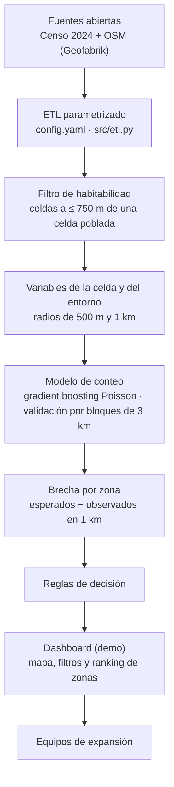
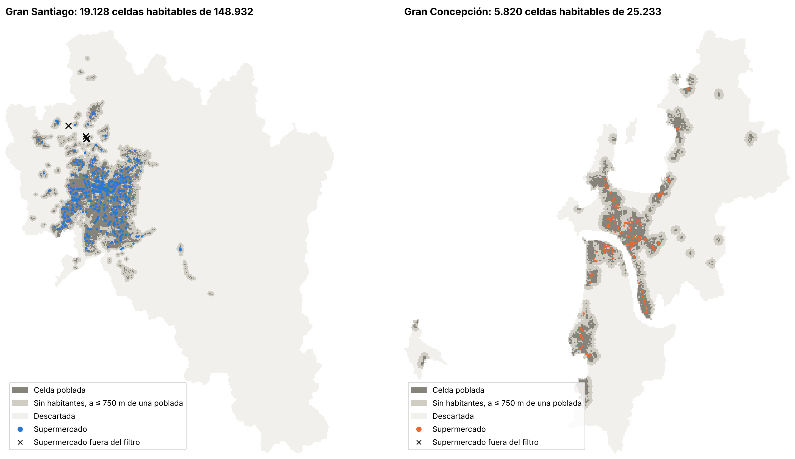
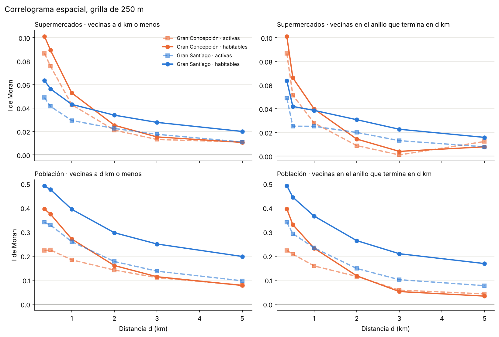
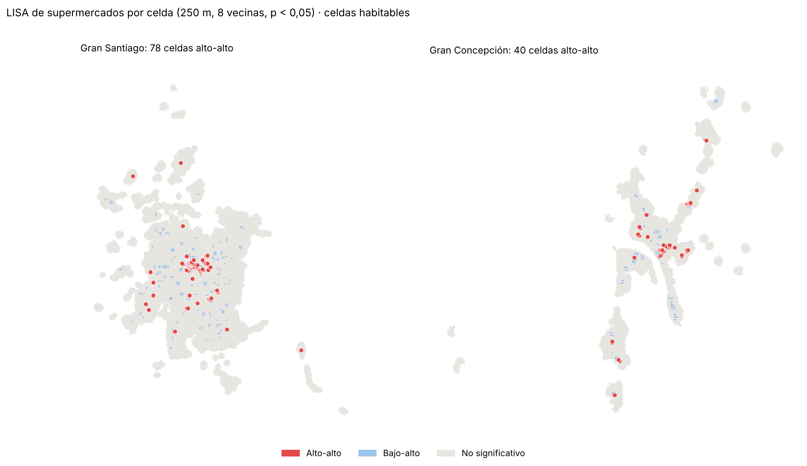
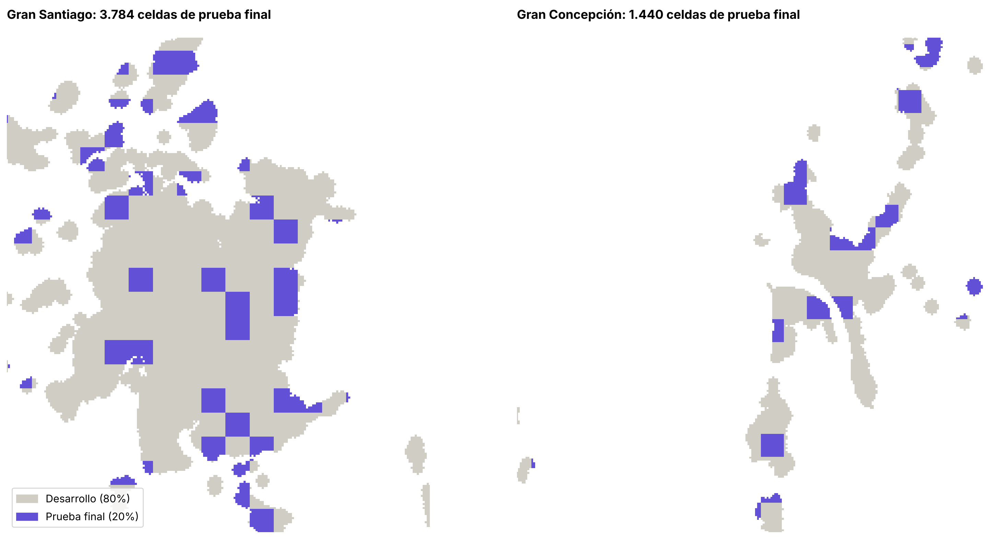
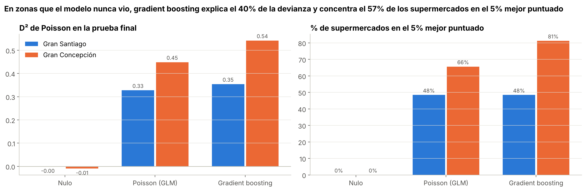
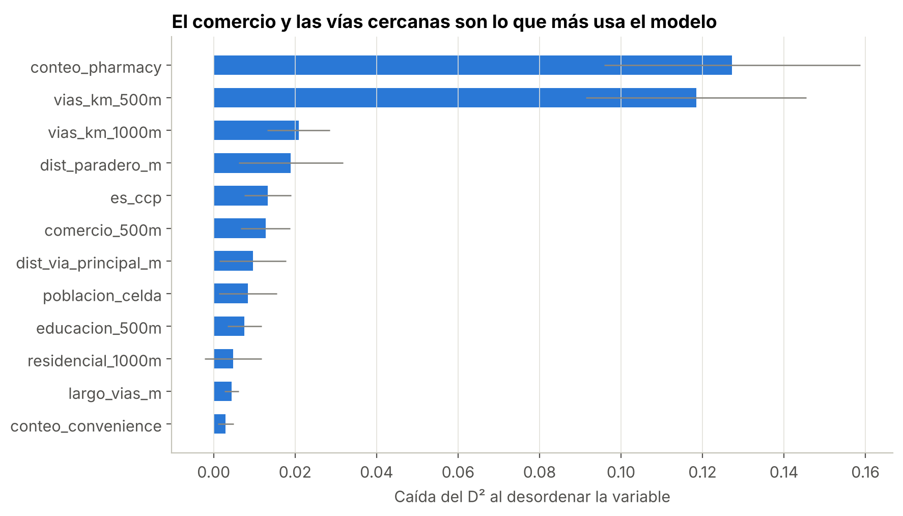
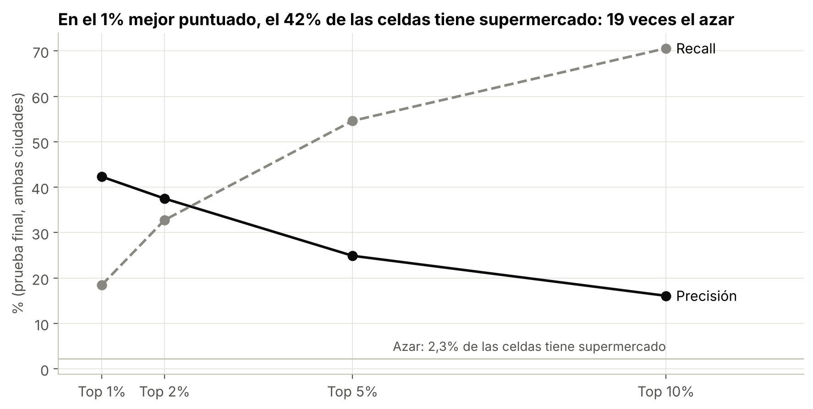
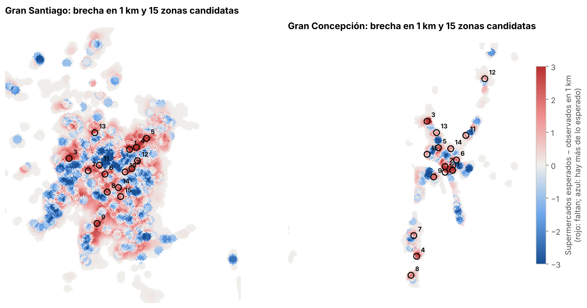

# ¿Dónde abrir el próximo supermercado? 🛒🗺️

Proyecto del curso *Data Analysis and Machine Learning* (Trabajo BI-ML 2026, Ingeniería Industrial, Universidad de Concepción). Usa solo datos abiertos, Censo 2024 y OpenStreetMap, para encontrar zonas del Gran Santiago y del Gran Concepción que hoy tienen menos supermercados de los que su demanda y accesibilidad harían esperar.

> **Estado:** v2.0 en desarrollo. El ETL v2, el filtro de celdas inhabitables, las variables de entorno, el diagnóstico espacial, el modelo y la brecha por zona están listos y corridos con los datos reales; el dashboard para la demo viene en la próxima iteración (ver [Historial de versiones](#historial-de-versiones)). La versión presentada en el avance queda en el tag [`v1.0`](https://github.com/MateoJr182/supermarket-location-analytics/tree/v1.0).

## Contenido

1. [Problema, pregunta y usuarios](#1-problema-pregunta-y-usuarios)
2. [Datos](#2-datos)
3. [Arquitectura y pipeline](#3-arquitectura-y-pipeline)
4. [Decisiones metodológicas](#4-decisiones-metodológicas)
5. [Resultados](#5-resultados)
6. [Riesgos de datos y limitaciones](#6-riesgos-de-datos-y-limitaciones)
7. [Cómo reproducir](#7-cómo-reproducir)
8. [Estructura del repositorio](#8-estructura-del-repositorio)
9. [Historial de versiones](#historial-de-versiones)
10. [Referencias](#referencias)

---

## 1. Problema, pregunta y usuarios

Abrir un supermercado es una inversión alta y difícil de revertir. Hoy la búsqueda de zonas se hace con estudios de mercado y visitas a terreno caso a caso, lo que es caro y difícil de repetir en otra ciudad. Falta un **primer filtro barato y replicable** que reduzca las zonas a estudiar.

**Pregunta de investigación**

> Con la oferta y el entorno urbano actuales (Censo 2024 + OSM), ¿qué zonas del Gran Santiago y del Gran Concepción tienen hoy menos supermercados de los que su demanda y accesibilidad harían esperar?

- El modelo aprende, con ambas ciudades a la vez, cuántos supermercados corresponden a cada contexto: demanda en el entorno, accesibilidad y actividad comercial.
- La oportunidad de cada zona es la **brecha = supermercados esperados − observados** en un radio caminable de 1 km.
- Es un corte transversal con datos de un solo momento: **no predice cómo crecerá la ciudad**, sino dónde conviene ubicar un supermercado hoy.

**Usuarios**

- Equipos de expansión de cadenas de supermercados, que usan el ranking de zonas como primer filtro antes del estudio de mercado y la visita a terreno.
- Municipios y planificadores interesados en el acceso a alimentos.

## 2. Datos

| Fuente | Archivo en `data/raw/` | Qué se usa | Fecha |
| --- | --- | --- | --- |
| [OpenStreetMap Chile (Geofabrik)](https://download.geofabrik.de/south-america/chile.html) | `chile.gpkg` | Vías, paraderos, uso de suelo residencial y 11 categorías de puntos de interés (puntos y polígonos) | Extracto del 2026-10-02 |
| [Censo 2024, manzanas (INE)](https://censo2024.ine.gob.cl/resultados/) | `Cartografia_censo2024_Pais_Manzanas.parquet` | Personas por manzana (`n_per`) | Censo 2024 |
| [Censo 2024, comunas (INE)](https://censo2024.ine.gob.cl/resultados/) | `Cartografia_censo2024_Pais_Comunal.parquet` | Límites comunales para armar cada ciudad | Censo 2024 |

**Áreas de estudio** (definidas en `config.yaml`)

- **Gran Santiago:** 39 comunas.
- **Gran Concepción:** 9 comunas: Concepción, Talcahuano, Hualpén, San Pedro de la Paz, Chiguayante, Penco, Coronel, Lota y Tomé. El Área Metropolitana oficial tiene 11; Hualqui y Santa Juana quedan fuera por ser mayormente rurales.

**Resumen por ciudad** (ETL v2, celdas de 250 m)

| | Gran Santiago | Gran Concepción |
| --- | ---: | ---: |
| Comunas | 39 | 9 |
| Habitantes (Censo 2024) | 6.532.737 | 954.408 |
| Supermercados (OSM) | 524 | 159 |
| Paraderos y estaciones | 12.416 | 2.460 |
| Puntos de interés (11 categorías, incluye supermercados) | 8.396 | 1.497 |
| Celdas | 148.932 | 25.233 |
| Celdas pobladas | 9.585 | 2.317 |

**Unidad de análisis:** celda cuadrada de 250 × 250 m (tamaño principal), con versiones de 125, 500 y 1000 m y una grilla de 250 m desplazada 125 m para el análisis de sensibilidad.

**Tablas de salida:** `data/processed/celdas_<ciudad>_<tamaño>m.parquet`, una fila por celda.

| Columna | Descripción |
| --- | --- |
| `id_celda` | Identificador estable: `<ciudad>_<tamaño>_<ix>_<iy>` |
| `ciudad`, `tamano_m`, `desfase_m` | Ciudad (`stgo`, `ccp`), lado de la celda en metros y desplazamiento de la grilla |
| `ix`, `iy`, `x`, `y` | Posición de la celda en la grilla y su centro en metros (UTM, ver `crs_utm`) |
| `frac_dentro` | Fracción de la celda dentro del área de estudio (1 = completa) |
| `n_supermercados` | **Variable objetivo:** supermercados OSM en la celda |
| `conteo_paraderos` | Paraderos y estaciones (`bus_stop`, `bus_station`, `station`) |
| `conteo_<categoría>` | Almacenes, malls, farmacias, ferias, colegios, universidades, institutos, hospitales, clínicas y recintos deportivos |
| `poblacion_celda` | Personas del Censo 2024 cuyo centroide de manzana cae en la celda |
| `largo_vias_m` | Metros de vías `primary`, `secondary`, `tertiary` y `trunk` en la celda |
| `dist_via_principal_m` | Distancia del centro de la celda a la vía `primary` o `trunk` más cercana |
| `frac_residencial` | Fracción del área de la celda con uso de suelo residencial en OSM |

**Tablas para el modelo:** `data/processed/modelo_<tamaño>m.parquet`, con ambas ciudades y solo las celdas habitables (a 750 m o menos de una celda poblada; ver [5.4](#54-filtro-de-celdas-inhabitables)). Tienen todas las columnas anteriores más:

| Columna | Descripción |
| --- | --- |
| `dist_poblada_m` | Distancia del centro de la celda a la celda poblada más cercana (0 si tiene habitantes) |
| `dist_paradero_m` | Distancia a la celda más cercana con un paradero o estación |
| `pob_<radio>`, `paraderos_<radio>` | Habitantes y paraderos en las celdas a 500 m o 1 km o menos (incluye la propia celda) |
| `comercio_<radio>` | Almacenes, malls, farmacias y ferias en el radio |
| `educacion_<radio>`, `salud_<radio>`, `deporte_<radio>` | Colegios, universidades e institutos; hospitales y clínicas; recintos deportivos |
| `vias_km_<radio>`, `residencial_<radio>` | Kilómetros de vías y fracción residencial promedio en el radio |
| `n_super_500m`, `n_super_1000m`, `dist_super_m` | Supermercados en el radio y distancia al más cercano. **Solo para la capa de decisión, no son predictores** |

**Predicciones:** `data/processed/predicciones_250m.parquet`, una fila por celda habitable de 250 m, es la entrada del dashboard ([5.7](#57-modelo) a [5.9](#59-brecha-y-zonas-candidatas)).

| Columna | Descripción |
| --- | --- |
| `comuna`, `lat`, `lon` | Comuna y centro de la celda en coordenadas geográficas |
| `esperado` | Supermercados esperados en la celda (gradient boosting, fuera de muestra, calibrado por ciudad) |
| `esperado_sin_calibrar`, `esperado_glm` | Predicción antes de calibrar y predicción del GLM de Poisson, como referencia |
| `puntaje_idoneidad` | Percentil (0–100) de `esperado` dentro de su ciudad |
| `esperado_1000m`, `n_super_1000m`, `brecha_1000m` | Esperados, observados y brecha (esperados − observados) en 1 km |
| `en_prueba_final` | `True` si la celda está en un bloque de la prueba final (20%) |
| `candidata` | `True` si la celda es una de las zonas candidatas |

## 3. Arquitectura y pipeline



| Etapa | Estado | Dónde |
| --- | --- | --- |
| ETL (grilla, conteos, censo, vías) | Listo (v2) | `src/etl.py`, `01_etl_v2.ipynb` |
| Filtro de habitabilidad y variables de entorno | Listo (v2) | `src/features.py`, `03_filtro_y_entorno.ipynb` |
| Diagnóstico espacial (Moran, correlograma, LISA) | Listo (v2) | `02_diagnostico_espacial.ipynb` |
| Modelo y brecha | Listo (v2) | `src/modelo.py`, `04_modelo.ipynb` |
| Dashboard | Pendiente | |

## 4. Decisiones metodológicas

Cada decisión responde a un punto del feedback de la presentación de avance o a un problema detectado en la v1. Los issues de GitHub registran la discusión de cada una.

| Decisión | Motivo | Versión |
| --- | --- | --- |
| Pregunta redefinida: brecha actual, no crecimiento futuro | Con datos de un solo momento no se puede predecir cómo crecerá la ciudad (feedback) | v2.0 |
| Variable objetivo de conteo (`n_supermercados`) | Hay celdas con más de un supermercado; la versión binaria pierde esa información (feedback) | v2.0 |
| Celdas completas alineadas a múltiplos del tamaño, sin recorte | En la v1, `gpd.clip` dejaba celdas de borde más chicas con conteos no comparables | v2.0 |
| Puntos asignados a la celda por índice, no con `sjoin` | Más rápido, sin dobles conteos en los bordes y permite recorrer varios tamaños | v2.0 |
| Sensibilidad con 125, 250, 500 y 1000 m y grilla desplazada | El resultado depende del tamaño y la posición de la celda (feedback; problema MAUP) | v2.0 |
| 250 m como tamaño principal; 125 m solo como extremo fino | A 125 m la mitad de las celdas con supermercado queda sin habitantes y a 1000 m se pierde la ubicación del terreno (ver [Resultados](#5-resultados)) | v2.0 |
| Vías y uso de suelo residencial como variables | En la v1 se extraían pero no se usaban | v2.0 |
| Salida en Parquet con coordenadas | Sin coordenadas no se pueden calcular variables de entorno ni validar por bloques | v2.0 |
| Gran Concepción con 9 comunas | Más casos de Concepción para entrenar; el área metropolitana oficial tiene 11 | v2.0 |
| Parámetros en `config.yaml` | Re-ejecutar con un nuevo extracto de OSM sin tocar el código | v2.0 |
| ETL v1 archivado en `archivo/` y marcado con el tag `v1.0` | Dejar visible la evolución sin confundir el notebook vigente | v2.0 |
| Filtro de celdas a ≤ X m de una celda poblada, con X = 750 m elegido desde los datos | A 250 m, el 15% de las celdas con supermercado no tiene habitantes; filtrar solo celdas pobladas las borraría (feedback). X es el menor valor que conserva el 99% de los supermercados | v2.0 |
| El mismo X para todos los tamaños de celda | Que el análisis de sensibilidad compare grillas sobre el mismo territorio | v2.0 |
| Variables del entorno en radios de 500 m y 1 km | La demanda de un supermercado está en el área que lo rodea; es la forma de incluir la correlación espacial en las variables (feedback) | v2.0 |
| Supermercados vecinos fuera de los predictores | Son la variable objetivo desplazada en el espacio: el modelo recomendaría abrir al lado de los existentes. Se usan solo en la capa de decisión | v2.0 |
| Medir la correlación espacial (Moran, correlograma, LISA) | La correlación espacial debe medirse antes de modelar (feedback) | v2.0 |
| Validar con bloques espaciales de 3 km (2 y 5 km como sensibilidad) | En el correlograma, el parecido entre celdas se apaga entre 2 y 3 km; con bloques más chicos el modelo se evaluaría con celdas vecinas a las de entrenamiento (ver [5.6](#56-diagnóstico-espacial)) | v2.0 |
| P de LISA recalculado contando los empates | Con casi todas las celdas en 0, `esda` marca como significativos empates exactos y el 66% de las celdas de Santiago salía "bajo-bajo" | v2.0 |
| Un solo modelo con ambas ciudades, con pesos para que cada ciudad pese lo mismo y una variable indicadora de ciudad | Entrenar en una ciudad y aplicar en otra no sirve porque el ajuste es distinto (feedback); sin pesos, Santiago (77% de las celdas) dominaría el ajuste | v2.0 |
| Prueba final con el 20% de los bloques de 3 km, apartada antes de cualquier decisión y medida una sola vez | Que el desempeño reportado no dependa de decisiones tomadas con esos mismos datos. Se sortea por ciudad y según si el bloque tiene supermercado, para que la prueba tenga ambas ciudades y una proporción de supermercados parecida al total | v2.0 |
| Todas las decisiones del modelo con el 80% de desarrollo y validación cruzada de 5 particiones por bloques de 3 km | Elegir la configuración, comparar modelos y revisar la validación sin mirar la prueba final | v2.0 |
| Gradient boosting con pérdida Poisson como modelo final; GLM de Poisson como referencia interpretable | En desarrollo explica más devianza (D² 0,34 contra 0,25) y concentra más supermercados en el 5% de celdas mejor puntuadas (50% contra 45%) | v2.0 |
| Ajuste ligero del gradient boosting: 4 configuraciones, se usa la de mayor D² en desarrollo | Las configuraciones complejas sobreajustan los polos comerciales y subestiman el total fuera de muestra | v2.0 |
| Poisson y no Binomial Negativa | La Binomial Negativa mejora poco el ajuste (AIC 3.809 contra 3.826 en desarrollo) y el modelo final es gradient boosting | v2.0 |
| No se optimiza la precisión; se reporta precisión y recall en el k% de celdas mejor puntuadas | Cambia lo propuesto en el avance. Con la pregunta nueva, las celdas puntuadas alto sin supermercado ("falsos positivos") son las oportunidades: optimizar la precisión dejaría solo lugares que ya tienen supermercado. El modelo se entrena con la devianza de Poisson | v2.0 |
| Brecha con predicciones fuera de muestra y calibradas por ciudad | Si la celda se predice con un modelo que la vio, el modelo "memoriza" los supermercados y la brecha sale cerca de 0; la calibración evita faltantes artificiales en Concepción, donde el modelo subestima el total | v2.0 |
| Zonas candidatas con reglas simples en `config.yaml` | Sin supermercado a 500 m, población en 1 km sobre la mediana, brecha positiva y 1,5 km entre zonas: reglas que un equipo de expansión puede discutir y cambiar | v2.0 |

## 5. Resultados

### 5.1 Sensibilidad al tamaño de celda (ETL v2)

Cada fila es una grilla distinta sobre los mismos datos: 524 supermercados en Gran Santiago y 159 en Gran Concepción. Fuente: [`resultados/etl_v2/resumen_tamanos.csv`](resultados/etl_v2/resumen_tamanos.csv).

| Ciudad | Celda | Celdas | Celdas pobladas | Celdas con supermercado | Con 2 o más | % con 2 o más | % sin habitantes |
| --- | --- | ---: | ---: | ---: | ---: | ---: | ---: |
| Gran Santiago | 125 m | 592.306 | 24.289 | 510 | 12 | 2,4% | 50,4% |
| Gran Santiago | **250 m** | 148.932 | 9.585 | 490 | 28 | 5,7% | 15,1% |
| Gran Santiago | 250 m desplazada 125 m | 148.927 | 9.642 | 489 | 33 | 6,7% | 13,5% |
| Gran Santiago | 500 m | 37.661 | 3.232 | 438 | 67 | 15,3% | 3,4% |
| Gran Santiago | 1000 m | 9.623 | 1.065 | 330 | 121 | 36,7% | 1,2% |
| Gran Concepción | 125 m | 98.542 | 5.370 | 152 | 6 | 3,9% | 44,1% |
| Gran Concepción | **250 m** | 25.233 | 2.317 | 138 | 17 | 12,3% | 15,2% |
| Gran Concepción | 250 m desplazada 125 m | 25.211 | 2.311 | 141 | 15 | 10,6% | 12,1% |
| Gran Concepción | 500 m | 6.580 | 883 | 112 | 33 | 29,5% | 3,6% |
| Gran Concepción | 1000 m | 1.783 | 338 | 80 | 40 | 50,0% | 0,0% |

Los porcentajes se calculan sobre las celdas con supermercado.

- **250 m se mantiene como tamaño principal.** A 125 m, la mitad de las celdas con supermercado no tiene habitantes (50,4% en Santiago y 44,1% en Concepción), porque la población se asigna por manzana y la celda queda más chica que el entorno de una manzana. A 1000 m, el 37% de las celdas con supermercado en Santiago y el 50% en Concepción tienen dos o más: la celda es demasiado gruesa para ubicar un terreno.
- **El conteo agrega información.** A 250 m, el 5,7% de las celdas con supermercado en Santiago y el 12,3% en Concepción tienen dos o más, algo que la variable binaria de la v1 no registraba.
- **La posición de la grilla casi no cambia el resultado.** Desplazar la grilla de 250 m en 125 m mueve las celdas con supermercado de 490 a 489 en Santiago y de 138 a 141 en Concepción.
- **El filtro de celdas inhabitables necesita una distancia X.** A 250 m, el 15% de las celdas con supermercado no tiene habitantes; un filtro de "solo celdas pobladas" las borraría.

### 5.2 Comparación con la v1 (celdas de 250 m)

| | Gran Santiago v1 | Gran Santiago v2 | Gran Concepción v1 | Gran Concepción v2 |
| --- | ---: | ---: | ---: | ---: |
| Comunas | 39 | 39 | 6 | 9 |
| Celdas | 148.911 | 148.932 | 10.501 | 25.233 |
| Celdas con supermercado | 486 | 490 | 120 | 138 |
| Habitantes | 6.532.737 | 6.532.737 | 742.804 | 954.408 |

En Santiago las diferencias son menores y vienen de usar celdas completas y asignar los puntos por índice. En Concepción el cambio viene de sumar Coronel, Lota y Tomé.

### 5.3 Mapa de control


### 5.4 Filtro de celdas inhabitables

Se conservan las celdas a X metros o menos de una celda poblada. X es el menor candidato que conserva al menos el 99% de los supermercados de ambas ciudades en la grilla de 250 m: **X = 750 m**. Fuente: [`resultados/features/curva_filtro_x.csv`](resultados/features/curva_filtro_x.csv).

| X | Supermercados conservados, Santiago | Supermercados conservados, Concepción | Ambas ciudades | Grilla que queda (ambas) |
| --- | ---: | ---: | ---: | ---: |
| 0 m (solo celdas pobladas) | 85,1% | 86,8% | 85,5% | 6,8% |
| 250 m | 98,3% | 97,5% | 98,1% | 10,0% |
| 500 m | 98,9% | 98,7% | 98,8% | 12,2% |
| **750 m** | **99,2%** | **100,0%** | **99,4%** | **14,3%** |
| 1000 m | 99,2% | 100,0% | 99,4% | 16,1% |


- Con X = 750 m quedan 19.128 celdas en Santiago (12,8% de la grilla) y 5.820 en Concepción (23,1%), con 520 de 524 y 159 de 159 supermercados. Toda la población queda dentro.
- Los 4 supermercados que quedan fuera están en el borde norte de Santiago, a entre 1,5 y 2 km de la celda poblada más cercana. Subir X a 2 km recuperaría solo 2 de ellos y sumaría unas 15 mil celdas al universo (de 24.948 a 40.342).
- El filtro cambia el desbalance del problema: dentro de las celdas habitables de 250 m, el 2,5% (Santiago) y el 2,4% (Concepción) tienen supermercado, contra el 0,3% y el 0,5% de la grilla completa.



### 5.5 Variables de entorno

Correlación de Spearman entre `n_supermercados` y cada variable, medida en la celda, en 500 m y en 1 km, en las celdas habitables de 250 m. Fuente: [`resultados/features/correlaciones_entorno_250m.csv`](resultados/features/correlaciones_entorno_250m.csv).


- **La población pesa más medida en el entorno.** En Santiago la correlación sube de 0,12 (celda) a 0,15 (1 km); en Concepción, de 0,14 a 0,17. Confirma que la demanda está en el área que rodea al supermercado.
- **El comercio y los paraderos pesan más en la misma celda.** El comercio baja de 0,28 (celda) a 0,16 (1 km) en Santiago: los supermercados se ubican junto a otros comercios, en los ejes y centros comerciales.
- **El modelo usa ambas escalas.** La tabla para el modelo tiene 33 variables predictoras: 15 de la celda y 18 del entorno.
- **Sobredispersión leve.** La varianza de `n_supermercados` es 1,1 veces su promedio en Santiago y 1,3 veces en Concepción: la regresión de Poisson sirve como modelo base y la Binomial Negativa queda como contraste.

### 5.6 Diagnóstico espacial

I de Moran global, correlograma y LISA de `n_supermercados` y `poblacion_celda` en la grilla de 250 m, con pesos binarios por distancia estandarizados por fila y 999 permutaciones. El universo principal son las celdas habitables (filtro X = 750 m); el notebook repite todo en las "celdas activas" (con población o algún punto de interés). Fuente: [`resultados/diagnostico_espacial/`](resultados/diagnostico_espacial/), notebook `02_diagnostico_espacial.ipynb`.

| Celdas habitables de 250 m | Gran Santiago | Gran Concepción |
| --- | ---: | ---: |
| I de Moran, supermercados (8 vecinas, 360 m) | 0,064 | 0,101 |
| I de Moran, población (8 vecinas, 360 m) | 0,492 | 0,395 |
| I de Moran, supermercados, anillo de 2 a 3 km | 0,023 | 0,004 |
| Celdas alto-alto del LISA (supermercados que contienen) | 78 (86) | 40 (48) |
| Spearman supermercados vs. población de la celda | 0,12 | 0,14 |
| Spearman supermercados vs. población a 1 km (sin la celda) | 0,15 | 0,17 |
| Bloques de 3 km (con supermercado) | 230 (98) | 106 (33) |

Todos los I de Moran de la tabla tienen p ≤ 0,05.



- **Hay correlación espacial, débil en los supermercados y fuerte en la población.** El I de los supermercados es bajo en parte porque el 97,5% de las celdas tiene 0.
- **El parecido entre celdas se apaga entre 2 y 3 km**, por eso la validación usará bloques de 3 km, con 2 y 5 km como sensibilidad. En Santiago la población sigue correlacionada a 5 km (I = 0,17) por el gradiente centro-periferia de toda la ciudad.
- **Los supermercados forman polos comerciales:** 78 celdas alto-alto en Santiago y 40 en Concepción. Con 999 permutaciones ninguna pasa un control de falsos descubrimientos, así que se leen como zonas candidatas y no como prueba celda por celda.
- **La población del entorno explica más que la de la celda**, lo que respalda las variables de entorno de [5.5](#55-variables-de-entorno). En la etapa del modelo se repetirá el I de Moran sobre los residuos.



### 5.7 Modelo

**Cómo se separaron los datos.** Antes de cualquier decisión se apartó como **prueba final** el 20% de los bloques de 3 km, sorteado por ciudad y según si el bloque tiene supermercado. Con el 80% restante (**desarrollo**) se eligió la configuración del gradient boosting y se compararon los modelos con validación cruzada de 5 particiones por bloques. Recién al final, los modelos se entrenaron con todo el desarrollo y se midieron **una sola vez** en la prueba final. Fuente: [`resultados/modelo/`](resultados/modelo/), notebook `04_modelo.ipynb`.

| Conjunto | Bloques de 3 km | Celdas | Supermercados |
| --- | ---: | ---: | ---: |
| Desarrollo (80%) | 268 | 19.724 | 550 |
| Prueba final (20%) | 68 (46 en Santiago, 22 en Concepción) | 5.224 (20,9%) | 129 (19,0%) |



**Desarrollo: validación cruzada por bloques en el 80%** (aquí se eligió el modelo)

| Modelo | D², Santiago | D², Concepción | D², ambas | PR-AUC | Supermercados en el 5% mejor puntuado |
| --- | ---: | ---: | ---: | ---: | ---: |
| Nulo (promedio por ciudad) | 0,00 | 0,00 | 0,00 | 0,02 | 4% |
| Poisson (GLM) | 0,27 | 0,18 | 0,25 | 0,20 | 45% |
| **Gradient boosting (Poisson)** | **0,32** | **0,41** | **0,34** | **0,23** | **50%** |

**Prueba final: 20% apartado, medido una sola vez** (entre corchetes, intervalo del 95% por remuestreo de bloques)

| Modelo | D², Santiago | D², Concepción | D², ambas | PR-AUC | Supermercados en el 5% mejor puntuado |
| --- | ---: | ---: | ---: | ---: | ---: |
| Nulo (promedio por ciudad) | 0,00 | −0,01 | 0,00 | 0,02 | 5% |
| Poisson (GLM) | 0,33 | 0,45 | 0,36 | 0,31 | 51% |
| **Gradient boosting (Poisson)** | **0,35** [0,26–0,44] | **0,54** [0,40–0,67] | **0,40** [0,32–0,48] | **0,30** [0,22–0,38] | **57%** [45–71] |



- **El gradient boosting es el modelo final**, elegido en desarrollo (D² 0,34 contra 0,25 del GLM). En la prueba final, en zonas que nunca vio, explica el 40% de la devianza y pone el 57% de los supermercados en el 5% de las celdas con mayor predicción.
- **La prueba final salió algo mejor que la validación cruzada** (0,40 contra 0,34), pero dentro de su intervalo: con 68 bloques la estimación varía, sobre todo en Concepción (22 bloques). La lectura prudente es que el modelo explica entre un tercio y dos quintos de la devianza en zonas nuevas.
- **La validación aleatoria infla poco al gradient boosting** (0,35 contra 0,34 con bloques de 3 km). El GLM varía más según el esquema (de 0,25 a 0,30) porque extrapola mal en algunos bloques. Es coherente con el diagnóstico espacial: la dependencia entre celdas con supermercado es débil.
- **El modelo absorbe casi toda la correlación espacial.** En las predicciones del mapa final, el I de Moran baja de 0,064 en los supermercados a 0,011 en los residuos en Santiago, y de 0,101 a 0,017 en Concepción. Queda un resto significativo pero muy chico (p = 0,013 y 0,022).
- **Lo que más usa el modelo es el comercio y las vías cercanas:** tener una farmacia en la celda y los kilómetros de vías en 500 m explican la mayor parte de la caída del D² al desordenar las variables. La población pesa menos por separado porque su información se reparte entre variables correlacionadas (celda, 500 m y 1 km).
- **Calibración del mapa final:** antes de calibrar, el modelo predice 532 supermercados en Santiago (observados: 520) y 141 en Concepción (observados: 159). Para la brecha se ajustan por un factor de 0,98 y 1,13.



#### Precisión y recall en la prueba final

Si se marca como "con supermercado" el k% de celdas con mayor predicción, la **precisión** es el porcentaje de celdas marcadas que tiene supermercado y el **recall**, el porcentaje de celdas con supermercado que quedó marcado. Al azar, la precisión sería 2,3% (la proporción de celdas con supermercado en la prueba final). Fuente: [`resultados/modelo/precision_recall_top.csv`](resultados/modelo/precision_recall_top.csv).

| Celdas marcadas | Celdas | Precisión | Recall |
| --- | ---: | ---: | ---: |
| Top 1% | 52 | 42% | 18% |
| Top 2% | 104 | 37,5% | 33% |
| Top 5% | 261 | 25% | 55% |
| Top 10% | 522 | 16% | 71% |



- En el 1% mejor puntuado, la precisión es **19 veces la del azar** (57% en Concepción y 37% en Santiago).
- **La precisión no se optimiza, y es un cambio respecto de la presentación de avance.** Entonces el modelo era un clasificador de presencia y se propuso priorizar la precisión. Con la pregunta nueva, las celdas que el modelo puntúa alto y no tienen supermercado (los "falsos positivos") son justamente las oportunidades de las que sale la brecha: un modelo con precisión perfecta solo marcaría lugares que ya tienen supermercado. Por eso el modelo se entrena con la devianza de Poisson y la precisión se usa para validar que el puntaje reconoce lugares "tipo supermercado".
- La precisión que le importa a un equipo de expansión es la de la **lista de zonas candidatas**, y no se puede medir con estos datos. Una aproximación barata es revisar las zonas en Google Maps y contar cuántas ya tienen un supermercado que OSM no registra.

### 5.8 Sensibilidad del modelo al tamaño de celda

El mismo modelo en todas las grillas, con los mismos bloques de prueba final apartados; las métricas son de validación cruzada en desarrollo. Para comparar zonas, la brecha se suma en cuadrados de 1 km comunes a todas. Fuente: [`resultados/modelo/sensibilidad_tamano.csv`](resultados/modelo/sensibilidad_tamano.csv).

| Celda | D² en desarrollo (ambas) | Supermercados en el 5% mejor puntuado | Zonas de 1 km del top 50 que coinciden con 250 m (Santiago / Concepción) | Correlación de rangos de la brecha con 250 m (Santiago / Concepción) |
| --- | ---: | ---: | ---: | ---: |
| 125 m | 0,29 | 51% | 76% / 78% | 0,96 / 0,90 |
| **250 m** | **0,34** | **50%** | — | — |
| 250 m desplazada 125 m | 0,34 | 50% | 52% / 64% | 0,73 / 0,68 |
| 500 m | 0,43 | 38% | 66% / 78% | 0,94 / 0,90 |
| 1000 m | 0,44 | 18% | 62% / 78% | 0,89 / 0,84 |

- **El D² sube con el tamaño de celda, pero la herramienta pierde precisión.** Con celdas grandes es más fácil acertar el conteo, pero el 5% de celdas mejor puntuadas cubre más territorio y captura menos supermercados: 18% a 1000 m contra 50% a 250 m.
- **125 y 250 m concentran lo mismo** (51% y 50%, sobre la misma superficie), pero 250 m explica más (D² 0,34 contra 0,29) y no tiene el problema de las celdas de 125 m, donde la mitad de las que tienen supermercado no tiene habitantes ([5.1](#51-sensibilidad-al-tamaño-de-celda-etl-v2)). **250 m se mantiene como tamaño principal.**
- **El orden de las zonas es estable entre tamaños** (correlación de rangos de 0,84 a 0,96), aunque solo coinciden exactamente entre el 52% y el 78% de las 50 zonas con mayor brecha. La grilla desplazada coincide menos porque sus celdas cruzan los bordes de los cuadrados de 1 km usados para comparar. Por eso las zonas candidatas se leen como sectores a revisar, no como celdas exactas.

### 5.9 Brecha y zonas candidatas

La **brecha** de cada celda es la suma de supermercados esperados en 1 km a la redonda menos los observados en ese radio. Para el mapa, cada celda se predice con un modelo que no vio su bloque (5 particiones por bloques sobre todas las celdas, con la configuración ya elegida en desarrollo). Las **zonas candidatas** cumplen las reglas de `config.yaml`: sin supermercados a 500 m o menos, población en 1 km sobre la mediana de su ciudad y brecha positiva; se elige la celda de mayor brecha, se descartan las que están a menos de 1,5 km y se repite hasta 15 zonas por ciudad. Lista completa: [`resultados/modelo/zonas_candidatas.csv`](resultados/modelo/zonas_candidatas.csv).



**Gran Santiago, 5 primeras zonas**

| # | Comuna | Brecha en 1 km | Esperados | Observados | Habitantes en 1 km | Mapa |
| ---: | --- | ---: | ---: | ---: | ---: | --- |
| 1 | Las Condes | 6,0 | 7,0 | 1 | 33.903 | [ver](https://www.google.com/maps?q=-33.416727,-70.595791) |
| 2 | Ñuñoa | 4,6 | 5,6 | 1 | 51.573 | [ver](https://www.google.com/maps?q=-33.455115,-70.591114) |
| 3 | Pudahuel | 4,6 | 4,6 | 0 | 41.045 | [ver](https://www.google.com/maps?q=-33.432806,-70.741289) |
| 4 | Las Condes | 4,3 | 7,3 | 3 | 46.325 | [ver](https://www.google.com/maps?q=-33.412425,-70.579582) |
| 5 | Las Condes | 3,6 | 4,6 | 1 | 25.749 | [ver](https://www.google.com/maps?q=-33.394698,-70.55507) |

**Gran Concepción, 5 primeras zonas**

| # | Comuna | Brecha en 1 km | Esperados | Observados | Habitantes en 1 km | Mapa |
| ---: | --- | ---: | ---: | ---: | ---: | --- |
| 1 | Concepción | 7,8 | 12,8 | 5 | 17.104 | [ver](https://www.google.com/maps?q=-36.830648,-73.041836) |
| 2 | Concepción | 5,5 | 9,5 | 4 | 21.346 | [ver](https://www.google.com/maps?q=-36.822005,-73.064479) |
| 3 | Talcahuano | 4,3 | 5,3 | 1 | 12.862 | [ver](https://www.google.com/maps?q=-36.714741,-73.120352) |
| 4 | Coronel | 3,4 | 4,4 | 1 | 5.742 | [ver](https://www.google.com/maps?q=-37.037327,-73.143346) |
| 5 | Talcahuano | 2,8 | 2,8 | 0 | 18.269 | [ver](https://www.google.com/maps?q=-36.777274,-73.085212) |

- Las zonas con mayor brecha combinan muchas vías y comercio con pocos supermercados en OSM. Tres de las cinco primeras de Santiago están en Las Condes, una comuna con mucho comercio: conviene revisarlas en Google Maps antes de leerlas como oportunidad, porque OSM puede tener supermercados sin mapear o etiquetados con otra categoría.
- En Concepción las dos primeras zonas están en el centro, donde el modelo espera más supermercados de los que hay en 1 km (12,8 y 9,5 esperados contra 5 y 4 observados).

## 6. Riesgos de datos y limitaciones

- **Cobertura desigual de OSM:** las comunas de mayores ingresos suelen estar mejor mapeadas, lo que sesga los conteos.
- **Etiqueta `supermarket`:** mezcla cadenas con locales chicos; se puede revisar la columna `name` para marcar cadenas.
- **Desfase temporal:** el Censo es de 2024 y el extracto de OSM de 2026; se registra la fecha de descarga en `config.yaml`.
- **Sesgo heredado:** el modelo aprende de las decisiones pasadas de las cadenas, incluido el sesgo socioeconómico, y no hay variable de ingreso.
- **Unidad espacial:** el resultado depende del tamaño y la posición de la celda; el análisis de sensibilidad lo acota.
- **Población fuera de manzanas:** el archivo de manzanas suma 16,2 millones de personas de los 18,5 millones censados; la diferencia es principalmente población rural o fuera de manzanas urbanas. Por eso algunos supermercados periféricos aparecen lejos de toda celda poblada (ver [5.4](#54-filtro-de-celdas-inhabitables)).
- **Lo que el modelo no ve:** precios de suelo, terrenos disponibles, normativa, ingresos de los hogares ni ventas. La brecha indica dónde mirar, no dónde invertir.
- **Prueba final chica:** son 68 bloques (22 en Concepción), así que las métricas por ciudad tienen intervalos amplios (ver [5.7](#57-modelo) y [Próximos pasos](#próximos-pasos)).
- **Privacidad:** se usan solo conteos agregados por manzana publicados por el INE; no hay datos personales.

### Próximos pasos

- **Una tercera ciudad.** El ETL y las variables de entorno leen las ciudades desde `config.yaml` y usan datos de todo el país (`chile.gpkg` y la cartografía del Censo), así que agregar una ciudad solo requiere sus comunas y su CRS UTM. En el modelo habría que cambiar el indicador `es_ccp` por uno por ciudad. Gran Valparaíso (Valparaíso, Viña del Mar, Concón, Quilpué y Villa Alemana) ampliaría la prueba final y permitiría evaluar el modelo en una ciudad con otra geografía; por sus cerros, probablemente convendría sumar una variable de pendiente, que el modelo hoy no tiene.
- **Por qué no se hizo en la v2.0:** con un tamaño parecido al de Gran Concepción, la prueba final crecería en unos 20 bloques y su intervalo se achicaría poco, sin agrandar la prueba de cada ciudad por separado. A cambio, habría cambiado todos los resultados cerca del cierre de la versión.

## 7. Cómo reproducir

1. Crear un entorno con Python 3.10 o superior e instalar las dependencias:

   ```bash
   pip install -r requirements.txt
   ```

2. Descargar los tres archivos de la tabla de [Datos](#2-datos) y dejarlos en `data/raw/` con esos nombres. No se suben al repositorio por su tamaño (1,7 GB en total).
3. Correr el ETL desde la raíz del repositorio, con el notebook `01_etl_v2.ipynb` o por consola:

   ```bash
   python -m src.etl
   ```

   Genera `data/processed/celdas_*.parquet`, `data/interim/*_capas.gpkg` y `resultados/etl_v2/`, y toma unos 15 minutos. Si un supermercado, paradero o habitante queda sin celda, la corrida se detiene.

4. Aplicar el filtro de celdas inhabitables y calcular las variables de entorno, con el notebook `03_filtro_y_entorno.ipynb` o por consola:

   ```bash
   python -m src.features
   ```

   Lee las tablas de `data/processed/celdas_*.parquet`, genera `data/processed/modelo_*.parquet` y `resultados/features/`, y toma menos de un minuto. No necesita los datos crudos.

5. Correr el diagnóstico espacial con el notebook `02_diagnostico_espacial.ipynb`. Lee `data/processed/`, genera `resultados/diagnostico_espacial/` y toma unos 3 minutos.
6. Entrenar y validar el modelo y calcular la brecha, con el notebook `04_modelo.ipynb` o por consola:

   ```bash
   python -m src.modelo
   ```

   Lee `data/processed/modelo_*.parquet`, genera `data/processed/predicciones_250m.parquet` y `resultados/modelo/`, y toma unos 3 minutos. Usa el archivo comunal de `data/raw/` solo para poner el nombre de la comuna; si no está, esa columna queda vacía.

Las tablas de `data/processed/` sí se versionan, así que los notebooks de análisis se pueden correr sin descargar los datos crudos. La versión de la presentación de avance se puede revisar en el tag [`v1.0`](https://github.com/MateoJr182/supermarket-location-analytics/tree/v1.0) o con `git checkout v1.0`.

## 8. Estructura del repositorio

```text
.
├── config.yaml                        # parámetros: rutas, comunas, tamaños de celda
├── src/
│   ├── etl.py                         # funciones del ETL v2
│   ├── features.py                    # filtro de celdas inhabitables y variables de entorno
│   └── modelo.py                      # modelos, validación por bloques, brecha y zonas candidatas
├── 01_etl_v2.ipynb                    # corre el ETL v2 y muestra los controles
├── 02_diagnostico_espacial.ipynb      # Moran global, correlograma, LISA y población de la celda vs. entorno
├── 03_filtro_y_entorno.ipynb          # elige X, aplica el filtro y revisa las variables de entorno
├── 04_modelo.ipynb                    # compara modelos, valida por bloques, sensibilidad y brecha
├── archivo/                           # v1 de la presentación de avance (tag v1.0)
│   ├── 01_etl_v1.ipynb
│   └── dataset_entrenamiento_<ciudad>.csv
├── data/
│   ├── raw/                           # datos crudos (no se versionan)
│   ├── interim/                       # capas intermedias por ciudad (no se versionan)
│   └── processed/                     # tablas por celda, para el modelo y predicciones (se versionan)
├── resultados/
│   ├── etl_v2/                        # resumen de tamaños y mapa de control
│   ├── features/                      # curva y mapa del filtro X, correlaciones de entorno
│   ├── diagnostico_espacial/          # Moran, correlograma, LISA, Spearman y bloques de validación
│   └── modelo/                        # partición, métricas de desarrollo y prueba final, precisión/recall, sensibilidad y zonas candidatas
├── requirements.txt
└── README.md
```

---

## Historial de versiones

### v2.0 — en desarrollo (desde 2026-10-18)

Responde al feedback de la presentación de avance. Ramas `ETL-V2`, `variables-entorno`, `diagnostico-espacial` y `modelo`.

**Listo**

- ETL reescrito como módulo (`src/etl.py`) con parámetros en `config.yaml` y un notebook que lo ejecuta (`01_etl_v2.ipynb`).
- Grilla de celdas completas alineadas a múltiplos del tamaño; columna `frac_dentro` para las celdas de borde.
- Asignación de puntos a celdas por índice.
- Variable objetivo de conteo: `n_supermercados` reemplaza a `target_supermercado`.
- Nuevas variables: `largo_vias_m`, `dist_via_principal_m`, `frac_residencial`.
- `densidad_poblacion` pasa a llamarse `poblacion_celda`, porque es un conteo de personas y no una densidad.
- Salida en Parquet con coordenadas para 125, 250, 500 y 1000 m, más una grilla de 250 m desplazada 125 m.
- Gran Concepción pasa de 6 a 9 comunas (Coronel, Lota y Tomé).
- Controles de calidad: la corrida se detiene si algún supermercado, paradero o habitante queda sin celda.
- Capas intermedias guardadas en `data/interim/` en vez de la raíz del repositorio.
- `requirements.txt` agregado y README reestructurado con decisiones e historial.
- Corrida con los datos reales y análisis de sensibilidad al tamaño de celda (ver [Resultados](#5-resultados)).
- ETL v1 archivado en `archivo/`; la versión de la presentación de avance queda en el tag `v1.0`.
- Filtro de celdas inhabitables (`src/features.py`): X = 750 m elegido con los datos; conserva el 99,4% de los supermercados y deja el 14,3% de la grilla.
- Variables de entorno en radios de 500 m y 1 km y variables de competencia separadas para la capa de decisión.
- Tablas para el modelo con ambas ciudades: `data/processed/modelo_<tamaño>m.parquet` (24.948 celdas habitables a 250 m).
- Diagnóstico espacial (`02_diagnostico_espacial.ipynb`): I de Moran global, correlograma acumulado y por anillos hasta 5 km, LISA con corrección de empates y Spearman entre supermercados y población de la celda y del entorno. Define bloques de validación de 3 km.
- Modelo (`src/modelo.py`, `04_modelo.ipynb`): un solo modelo con ambas ciudades. Prueba final con el 20% de los bloques de 3 km apartado antes de cualquier decisión; elección de la configuración y comparación de modelos solo con el 80% de desarrollo (validación cruzada por bloques). Gradient boosting Poisson contra GLM de Poisson y un modelo nulo: D² 0,34 en desarrollo y 0,40 en la prueba final, con intervalos bootstrap y precisión/recall en el k% mejor puntuado. También: validación aleatoria contra bloques de 1, 2, 3 y 5 km, I de Moran de los residuos, importancia de variables, coeficientes del GLM y prueba de sobredispersión.
- Sensibilidad del modelo al tamaño de celda (125, 250, 500 y 1000 m y grilla desplazada), con métricas de desarrollo: 250 m se mantiene como tamaño principal.
- Brecha por zona (esperados − observados en 1 km) con predicciones fuera de muestra y calibradas por ciudad, y 15 zonas candidatas por ciudad con comuna y enlace a Google Maps (`data/processed/predicciones_250m.parquet`, `resultados/modelo/zonas_candidatas.csv`).

**Pendiente en esta versión**

- Dashboard para la demo, a partir de `data/processed/predicciones_250m.parquet`.

### [v1.0](https://github.com/MateoJr182/supermarket-location-analytics/tree/v1.0) — base de la presentación de avance (2026-10-07)

- Gran Santiago ampliado a 39 comunas según la definición del INE (PR #1).
- Base para la presentación de avance: descriptivo por ciudad y correlaciones.

**Feedback recibido en la presentación de avance**

1. Considerar bien la correlación espacial.
2. Revisar qué tan sensible es el resultado al tamaño de celda.
3. Usar la cantidad de supermercados por celda en vez de una variable binaria.
4. Descartar celdas inhabitables (cerros, cordillera) con un criterio de distancia a celdas pobladas.
5. No entrenar en una ciudad para aplicar en otra: muestrear espacialmente ambas ciudades.
6. Redefinir el tema: con datos de un solo momento no se puede predecir el crecimiento de la ciudad, sino dónde conviene ubicar un supermercado hoy.

### v0.1 — primer ETL (2026-10-06)

- Notebook `01_spatial_data_processing.ipynb` (hoy `archivo/01_etl_v1.ipynb`): máscaras comunales, capas OSM (puntos de interés como puntos y polígonos sin duplicados), grilla de 250 m recortada a cada ciudad, variable binaria de supermercado, conteos por categoría y población del Censo 2024 por centroide de manzana.
- CSV de entrenamiento por ciudad en `data/processed/`.

---

## Referencias

- Roberts, D. R., Bahn, V., Ciuti, S., et al. (2017). [Cross-validation strategies for data with temporal, spatial, hierarchical, or phylogenetic structure](https://doi.org/10.1111/ecog.02881). *Ecography*, 40(8), 913–929.
- Chen, X., Ye, X., Widener, M. J., et al. (2022). [A systematic review of the modifiable areal unit problem (MAUP) in community food environmental research](https://link.springer.com/article/10.1007/s44212-022-00021-1). *Urban Informatics*.
- Instituto Nacional de Estadísticas (2024). [Censo de Población y Vivienda 2024: resultados y cartografía](https://censo2024.ine.gob.cl/resultados/).
- Instituto Nacional de Estadísticas (2025). [Primeros resultados del Censo 2024: 18.480.432 personas fueron censadas en Chile](https://www.ine.gob.cl/sala-de-prensa/prensa/general/noticia/2025/03/27/primeros-resultados-del-censo-2024-18.480.432-personas-fueron-censadas-en-chile-manteni%C3%A9ndose-la-tendencia-de-envejecimiento-de-la-poblaci%C3%B3n).
- Geofabrik (2026). [OpenStreetMap data extracts: Chile](https://download.geofabrik.de/south-america/chile.html).
- Consejo de Políticas de Infraestructura. [Más inversión y nueva planificación: lo que trae la nueva Área Metropolitana penquista](https://cpichile.org/mas-inversion-y-nueva-planificacion-lo-que-trae-la-nueva-area-metropolitana-penquista/).

## Autores

- Elizabeth Echeverría
- Mateo Jara
