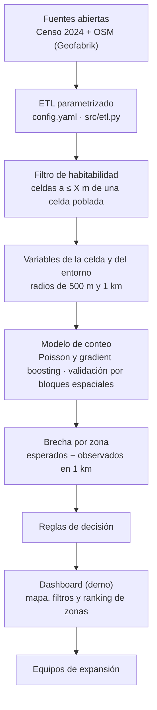

# ¿Dónde abrir el próximo supermercado? 🛒🗺️

Proyecto del curso *Data Analysis and Machine Learning* (Trabajo BI-ML 2026, Ingeniería Industrial, Universidad de Concepción). Usa solo datos abiertos, Censo 2024 y OpenStreetMap, para encontrar zonas del Gran Santiago y del Gran Concepción que hoy tienen menos supermercados de los que su demanda y accesibilidad harían esperar.

> **Estado:** v2.0 en desarrollo. El ETL v2 está listo; el filtro de celdas inhabitables, las variables de entorno, el modelo y el dashboard vienen en las próximas iteraciones (ver [Historial de versiones](#historial-de-versiones)).

## Contenido

1. [Problema, pregunta y usuarios](#1-problema-pregunta-y-usuarios)
2. [Datos](#2-datos)
3. [Arquitectura y pipeline](#3-arquitectura-y-pipeline)
4. [Decisiones metodológicas](#4-decisiones-metodológicas)
5. [Resultados](#5-resultados)
6. [Riesgos de datos y limitaciones](#6-riesgos-de-datos-y-limitaciones)
7. [Cómo reproducir](#7-cómo-reproducir)
8. [Estructura del repositorio](#8-estructura-del-repositorio)
9. [Historial de versiones](#historial-de-versiones)
10. [Referencias](#referencias)

---

## 1. Problema, pregunta y usuarios

Abrir un supermercado es una inversión alta y difícil de revertir. Hoy la búsqueda de zonas se hace con estudios de mercado y visitas a terreno caso a caso, lo que es caro y difícil de repetir en otra ciudad. Falta un **primer filtro barato y replicable** que reduzca las zonas a estudiar.

**Pregunta de investigación**

> Con la oferta y el entorno urbano actuales (Censo 2024 + OSM), ¿qué zonas del Gran Santiago y del Gran Concepción tienen hoy menos supermercados de los que su demanda y accesibilidad harían esperar?

- El modelo aprende, con ambas ciudades a la vez, cuántos supermercados corresponden a cada contexto: demanda en el entorno, accesibilidad y actividad comercial.
- La oportunidad de cada zona es la **brecha = supermercados esperados − observados** en un radio caminable de 1 km.
- Es un corte transversal con datos de un solo momento: **no predice cómo crecerá la ciudad**, sino dónde conviene ubicar un supermercado hoy.

**Usuarios**

- Equipos de expansión de cadenas de supermercados, que usan el ranking de zonas como primer filtro antes del estudio de mercado y la visita a terreno.
- Municipios y planificadores interesados en el acceso a alimentos.

## 2. Datos

| Fuente | Archivo en `data/raw/` | Qué se usa | Fecha |
| --- | --- | --- | --- |
| [OpenStreetMap Chile (Geofabrik)](https://download.geofabrik.de/south-america/chile.html) | `chile.gpkg` | Vías, paraderos, uso de suelo residencial y 11 categorías de puntos de interés (puntos y polígonos) | Extracto del 2026-10-02 (por confirmar) |
| [Censo 2024, manzanas (INE)](https://censo2024.ine.gob.cl/resultados/) | `Cartografia_censo2024_Pais_Manzanas.parquet` | Personas por manzana (`n_per`) | Censo 2024 |
| [Censo 2024, comunas (INE)](https://censo2024.ine.gob.cl/resultados/) | `Cartografia_censo2024_Pais_Comunal.parquet` | Límites comunales para armar cada ciudad | Censo 2024 |

**Áreas de estudio** (definidas en `config.yaml`)

- **Gran Santiago:** 39 comunas.
- **Gran Concepción:** 9 comunas: Concepción, Talcahuano, Hualpén, San Pedro de la Paz, Chiguayante, Penco, Coronel, Lota y Tomé. El Área Metropolitana oficial tiene 11; Hualqui y Santa Juana quedan fuera por ser mayormente rurales.

**Unidad de análisis:** celda cuadrada de 250 × 250 m (tamaño principal), con versiones de 125, 500 y 1000 m y una grilla de 250 m desplazada 125 m para el análisis de sensibilidad.

**Tablas de salida:** `data/processed/celdas_<ciudad>_<tamaño>m.parquet`, una fila por celda.

| Columna | Descripción |
| --- | --- |
| `id_celda` | Identificador estable: `<ciudad>_<tamaño>_<ix>_<iy>` |
| `ciudad`, `tamano_m`, `desfase_m` | Ciudad (`stgo`, `ccp`), lado de la celda en metros y desplazamiento de la grilla |
| `ix`, `iy`, `x`, `y` | Posición de la celda en la grilla y su centro en metros (UTM, ver `crs_utm`) |
| `frac_dentro` | Fracción de la celda dentro del área de estudio (1 = completa) |
| `n_supermercados` | **Variable objetivo:** supermercados OSM en la celda |
| `conteo_paraderos` | Paraderos y estaciones (`bus_stop`, `bus_station`, `station`) |
| `conteo_<categoría>` | Almacenes, malls, farmacias, ferias, colegios, universidades, institutos, hospitales, clínicas y recintos deportivos |
| `poblacion_celda` | Personas del Censo 2024 cuyo centroide de manzana cae en la celda |
| `largo_vias_m` | Metros de vías `primary`, `secondary`, `tertiary` y `trunk` en la celda |
| `dist_via_principal_m` | Distancia del centro de la celda a la vía `primary` o `trunk` más cercana |
| `frac_residencial` | Fracción del área de la celda con uso de suelo residencial en OSM |

## 3. Arquitectura y pipeline



| Etapa | Estado | Dónde |
| --- | --- | --- |
| ETL (grilla, conteos, censo, vías) | Listo (v2) | `src/etl.py`, `01_etl_v2.ipynb` |
| Filtro de habitabilidad y variables de entorno | En desarrollo | próximo notebook |
| Diagnóstico espacial (Moran, LISA) | En desarrollo | `02_diagnostico_espacial.ipynb` |
| Modelo y brecha | Pendiente | |
| Dashboard | Pendiente | |

## 4. Decisiones metodológicas

Cada decisión responde a un punto del feedback de la presentación de avance o a un problema detectado en la v1. Los issues de GitHub registran la discusión de cada una.

| Decisión | Motivo | Versión |
| --- | --- | --- |
| Pregunta redefinida: brecha actual, no crecimiento futuro | Con datos de un solo momento no se puede predecir cómo crecerá la ciudad (feedback) | v2.0 |
| Variable objetivo de conteo (`n_supermercados`) | Hay celdas con más de un supermercado; la versión binaria pierde esa información (feedback) | v2.0 |
| Celdas completas alineadas a múltiplos del tamaño, sin recorte | En la v1, `gpd.clip` dejaba celdas de borde más chicas con conteos no comparables | v2.0 |
| Puntos asignados a la celda por índice, no con `sjoin` | Más rápido, sin dobles conteos en los bordes y permite recorrer varios tamaños | v2.0 |
| Sensibilidad con 125, 250, 500 y 1000 m y grilla desplazada | El resultado depende del tamaño y la posición de la celda (feedback; problema MAUP) | v2.0 |
| 250 m como tamaño principal; 125 m solo como extremo fino | A 125 m casi todas las celdas tienen 0 o 1 supermercado y la población por manzana queda dispersa | v2.0 |
| Vías y uso de suelo residencial como variables | En la v1 se extraían pero no se usaban | v2.0 |
| Salida en Parquet con coordenadas | Sin coordenadas no se pueden calcular variables de entorno ni validar por bloques | v2.0 |
| Gran Concepción con 9 comunas | Más casos de Concepción para entrenar; el área metropolitana oficial tiene 11 | v2.0 |
| Parámetros en `config.yaml` | Re-ejecutar con un nuevo extracto de OSM sin tocar el código | v2.0 |
| Filtro de celdas a ≤ X m de una celda poblada, con X elegido desde los datos | El 14% de las celdas con supermercado (v1) no tiene habitantes; filtrar solo celdas pobladas los borraría (feedback) | v2.0, pendiente |
| Variables del entorno (500 m y 1 km) y validación por bloques espaciales | La correlación espacial debe medirse, incluirse en las variables y considerarse al validar (feedback) | v2.0, pendiente |
| Un solo modelo con ambas ciudades | Entrenar en una ciudad y aplicar en otra no sirve porque el ajuste es distinto (feedback) | v2.0, pendiente |

## 5. Resultados

*Se completa al correr el ETL v2 con los datos reales:* tabla de `resultados/etl_v2/resumen_tamanos.csv` (celdas, celdas con supermercado y con dos o más, por ciudad y tamaño) y mapa de control `resultados/etl_v2/mapa_control_250m.png`.


## 6. Riesgos de datos y limitaciones

- **Cobertura desigual de OSM:** las comunas de mayores ingresos suelen estar mejor mapeadas, lo que sesga los conteos.
- **Etiqueta `supermarket`:** mezcla cadenas con locales chicos; se puede revisar la columna `name` para marcar cadenas.
- **Desfase temporal:** el Censo es de 2024 y el extracto de OSM de 2026; se registra la fecha de descarga en `config.yaml`.
- **Sesgo heredado:** el modelo aprende de las decisiones pasadas de las cadenas, incluido el sesgo socioeconómico, y no hay variable de ingreso.
- **Unidad espacial:** el resultado depende del tamaño y la posición de la celda; el análisis de sensibilidad lo acota.
- **Privacidad:** se usan solo conteos agregados por manzana publicados por el INE; no hay datos personales.

## 7. Cómo reproducir

1. Crear un entorno con Python 3.10 o superior e instalar las dependencias:

   ```bash
   pip install -r requirements.txt
   ```

2. Descargar los tres archivos de la tabla de [Datos](#2-datos) y dejarlos en `data/raw/` con esos nombres. No se suben al repositorio por su tamaño (1,7 GB en total).
3. Correr el ETL desde la raíz del repositorio, con el notebook `01_etl_v2.ipynb` o por consola:

   ```bash
   python -m src.etl
   ```

   Genera `data/processed/celdas_*.parquet`, `data/interim/*_capas.gpkg` y `resultados/etl_v2/`. Si un supermercado, paradero o habitante queda sin celda, la corrida se detiene.

Las tablas de `data/processed/` sí se versionan, así que los notebooks de análisis se pueden correr sin descargar los datos crudos.

## 8. Estructura del repositorio

```text
.
├── config.yaml                        # parámetros: rutas, comunas, tamaños de celda
├── src/
│   └── etl.py                         # funciones del ETL v2
├── 01_etl_v2.ipynb                    # corre el ETL v2 y muestra los controles
├── 01_spatial_data_processing.ipynb   # ETL v1 (histórico, presentación de avance)
├── data/
│   ├── raw/                           # datos crudos (no se versionan)
│   ├── interim/                       # capas intermedias por ciudad (no se versionan)
│   └── processed/                     # tablas por celda (se versionan)
├── resultados/                        # tablas y figuras generadas
├── requirements.txt
└── README.md
```

---

## Historial de versiones

### v2.0 — en desarrollo (desde 2026-11-18)

Responde al feedback de la presentación de avance. Rama `ETL-V2`.

**Listo**

- ETL reescrito como módulo (`src/etl.py`) con parámetros en `config.yaml` y un notebook que lo ejecuta (`01_etl_v2.ipynb`).
- Grilla de celdas completas alineadas a múltiplos del tamaño; columna `frac_dentro` para las celdas de borde.
- Asignación de puntos a celdas por índice.
- Variable objetivo de conteo: `n_supermercados` reemplaza a `target_supermercado`.
- Nuevas variables: `largo_vias_m`, `dist_via_principal_m`, `frac_residencial`.
- `densidad_poblacion` pasa a llamarse `poblacion_celda`, porque es un conteo de personas y no una densidad.
- Salida en Parquet con coordenadas para 125, 250, 500 y 1000 m, más una grilla de 250 m desplazada 125 m.
- Gran Concepción pasa de 6 a 9 comunas (Coronel, Lota y Tomé).
- Controles de calidad: la corrida se detiene si algún supermercado, paradero o habitante queda sin celda.
- Capas intermedias guardadas en `data/interim/` en vez de la raíz del repositorio.
- `requirements.txt` agregado y README reestructurado con decisiones e historial.

**Pendiente en esta versión**

- Filtro de celdas inhabitables con distancia X.
- Variables del entorno (500 m y 1 km) y diagnóstico de correlación espacial.
- Modelo de conteo con ambas ciudades y validación por bloques espaciales.
- Brecha por zona y dashboard para la demo.

### v1.0 — base de la presentación de avance (2026-10-07)

- Gran Santiago ampliado a 39 comunas según la definición del INE (PR #1).
- Base para la presentación de avance: descriptivo por ciudad y correlaciones.

**Feedback recibido en la presentación de avance**

1. Considerar bien la correlación espacial.
2. Revisar qué tan sensible es el resultado al tamaño de celda.
3. Usar la cantidad de supermercados por celda en vez de una variable binaria.
4. Descartar celdas inhabitables (cerros, cordillera) con un criterio de distancia a celdas pobladas.
5. No entrenar en una ciudad para aplicar en otra: muestrear espacialmente ambas ciudades.
6. Redefinir el tema: con datos de un solo momento no se puede predecir el crecimiento de la ciudad, sino dónde conviene ubicar un supermercado hoy.

### v0.1 — primer ETL (2026-10-06)

- Notebook `01_spatial_data_processing.ipynb`: máscaras comunales, capas OSM (puntos de interés como puntos y polígonos sin duplicados), grilla de 250 m recortada a cada ciudad, variable binaria de supermercado, conteos por categoría y población del Censo 2024 por centroide de manzana.
- CSV de entrenamiento por ciudad en `data/processed/`.

---

## Referencias

- Chen, X., Ye, X., Widener, M. J., et al. (2022). [A systematic review of the modifiable areal unit problem (MAUP) in community food environmental research](https://link.springer.com/article/10.1007/s44212-022-00021-1). *Urban Informatics*.
- Instituto Nacional de Estadísticas (2024). [Censo de Población y Vivienda 2024: resultados y cartografía](https://censo2024.ine.gob.cl/resultados/).
- Geofabrik (2026). [OpenStreetMap data extracts: Chile](https://download.geofabrik.de/south-america/chile.html).
- Consejo de Políticas de Infraestructura. [Más inversión y nueva planificación: lo que trae la nueva Área Metropolitana penquista](https://cpichile.org/mas-inversion-y-nueva-planificacion-lo-que-trae-la-nueva-area-metropolitana-penquista/).

## Autores

- Elizabeth Echeverría
- Mateo Jara
